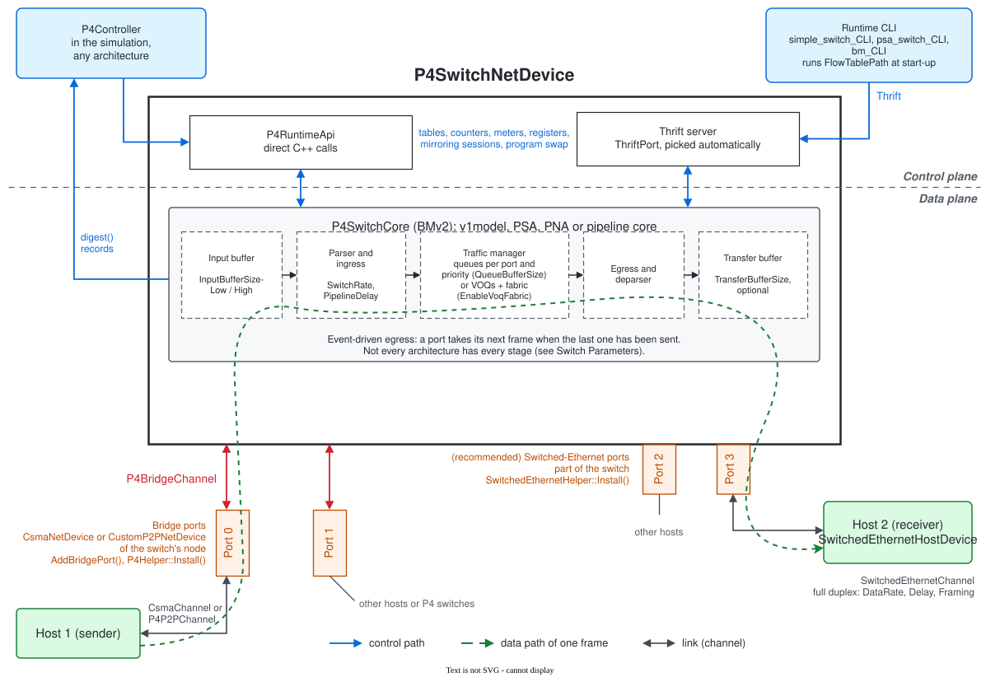

# P4sim in ns-3

<p align="center">
  <a href="https://mingyumaz.github.io/p4sim/"></a>
  <a href="https://arxiv.org/abs/2503.17554"></a>
  <a href="https://github.com/HapCommSys/p4sim-artifact-icns3"></a>
  <a href="https://github.com/p4lang/gsoc/blob/main/program/2025/README.md"></a>
  <a href="https://github.com/p4lang/gsoc/blob/main/program/2026/README.md"></a>
</p>

P4sim runs P4 programs in the [ns-3 network simulator](https://www.nsnam.org/): switches execute their P4 program on the BMv2 behavioral model, while ns-3 provides the topology, the traffic and the time. This lets you evaluate programmable networks in end-to-end simulations.

**Website:** [mingyumaz.github.io/p4sim](https://mingyumaz.github.io/p4sim/) gives an overview of P4sim, the [roadmap](https://mingyumaz.github.io/p4sim/roadmap/) and an animated look [inside the switch](https://mingyumaz.github.io/p4sim/inside/).

P4sim is open-source software licensed under the Apache License 2.0; some files are under GPL-2.0-only (see [License](#license)).

### Key Features

* **BMv2 behaviour**: the pipeline is [BMv2](https://github.com/p4lang/behavioral-model), the reference model of the P4 community. P4 programs written for BMv2 run unchanged, for v1model, PSA and PNA, and so do their flow-table files (on PNA without the time commands of `pna_nic_CLI`).
* **ns-3 integration**: topology, traffic and timing come from ns-3 (ns-3.39 to ns-3.49), so P4sim combines with the other ns-3 modules.
* **Timing**: links serialise every frame at their data rate, a congested port sends back to back at its line rate, and the pipeline can have a packet rate (`SwitchRate`) and a latency (`PipelineDelay`). Optional: a port queue after the egress (`TransferBufferSize`), and a traffic manager with virtual output queues that models the fabric of a switch.
* **Control plane**: flow-table files at start-up; during the simulation, `P4Controller` changes tables, counters, meters, registers and mirroring sessions, learns from `digest()` records and swaps the P4 program.
* **Scale**: built for large networks and high traffic rates.

---

### Architectural Overview

<p align="center">
  
</p>

A `P4SwitchNetDevice` runs a P4 program on BMv2 inside the simulation. The figure follows one frame (green) from Host 1 to Host 2:

1. **Two kinds of port**, which can be mixed in one switch (see [Switch ports](#switch-ports)):
   - **Switched-Ethernet ports** (right, recommended) are part of the switch: each port is a full-duplex `SwitchedEthernetChannel`. They model a real switch port more closely: the switch puts each frame on the wire itself, so it knows exactly when the frame has left, and the backlog stays in its own queues. The channel can add the Ethernet overhead on the wire (`Framing`).
   - **Bridge ports** (left) are ordinary ns-3 devices of the switch's node, such as a CSMA or a P4 point-to-point device. They connect the switch most easily to other ns-3 modules and devices, and the topology reader builds its networks with them. P4sim 1.x had only these.
2. **The pipeline.** `P4SwitchCore` runs the program on BMv2 (v1model, PSA, PNA or the pipeline core): input buffer, parser and ingress, traffic manager, egress and deparser, and an optional transfer buffer. Each stage has its attributes (see [Switch Parameters](#switch-parameters)); not every architecture has every stage.
3. **Event-driven egress.** A port takes its next frame from the traffic manager when it has sent the last one, so a congested port sends back to back at its line rate.
4. **The control plane.** At start-up, the runtime CLI of the architecture runs the flow-table file (`FlowTablePath`) through the switch's Thrift server. During the simulation, `P4Controller` changes tables, counters, meters, registers and mirroring sessions through `P4RuntimeApi`, learns from `digest()` records and swaps the P4 program.

The figure is an editable draw.io SVG: open [doc/figures/p4sim-architecture.drawio.svg](doc/figures/p4sim-architecture.drawio.svg) in [draw.io](https://www.drawio.com/) to change it.

Branches: `main` holds P4sim 2.0, which added the switched-Ethernet ports, the event-driven egress (v1model, PSA and PNA), the traffic manager and `PipelineDelay`. `main-deprecated` keeps the 1.x line (v1.0.0 and its later fixes, bridge ports only); it gets no more changes.

### Publications

- Mingyu Ma, Giang T. Nguyen. **"P4sim: Programming Protocol-independent Packet Processors in ns-3."** 2025. [[ACM DL]](https://dl.acm.org/doi/10.1145/3747204.3747210) [[arXiv]](https://arxiv.org/abs/2503.17554)
- **Reproducibility artifact:** [p4sim-artifact-icns3](https://github.com/HapCommSys/p4sim-artifact-icns3) — accepted at the 2025 International Conference on ns-3 (ICNS3).

Our implementation builds upon the P4-driven Network Simulator Module described in:

- Bai, Jiasong, *et al.* **"NS4: Enabling programmable data plane simulation."** Proc. of the Symposium on SDN Research, pp. 1–7, 2018. [[ACM DL]](https://dl.acm.org/doi/abs/10.1145/3185467.3185470)
- Fan, Chengze, *et al.* **"NS4: A P4-driven network simulator."** Proc. of the SIGCOMM Posters and Demos, pp. 105–107, 2017. [[ACM DL]](https://dl.acm.org/doi/10.1145/3123878.3132002)

---

## Installation & Setup

P4sim is an ns-3 module: it lives in `contrib/p4sim` of an ns-3 tree and needs BMv2 and the P4 compiler p4c. It builds with ns-3.39 to ns-3.49 and is tested with ns-3.39 and ns-3.49 and BMv2 1.15.8. There are four ways to set it up:

| Way | Time | Where |
|---|---|---|
| **[Quick installation](#quick-installation)** with `install.sh` | about 6 minutes on 16 cores | Ubuntu 24.04 or 26.04, also in WSL2 |
| **[Docker](doc/docker.md)** | 6 to 30 minutes on 32 to 8 cores | any x86-64 host with Docker; nothing is installed on the host |
| [Step by step](doc/installation.md#install-step-by-step), with the P4 tools of p4lang/tutorials | 1 to 2 hours, 15 GB | Ubuntu 24.04 |
| [Virtual machine](doc/installation.md#install-in-a-virtual-machine) | 1 to 2 hours | Vagrant and VirtualBox |

### Quick installation

On Ubuntu 24.04 or 26.04 (also in WSL2):

```bash
sudo apt update && sudo apt install -y git
mkdir -p ~/workdir && cd ~/workdir
git clone --depth 1 -b ns-3.39 https://github.com/nsnam/ns-3-dev-git.git ns3.39
git clone https://github.com/HapCommSys/p4sim.git ns3.39/contrib/p4sim
ns3.39/contrib/p4sim/install.sh
```

[`install.sh`](install.sh) asks for your sudo password, installs the Ubuntu packages and p4c (prebuilt, from the p4lang repository), builds BMv2 1.15.8 into `/usr/local`, and builds and tests ns-3 with P4sim. It ends with the number of passed test suites and examples. For ns-3.49, replace `ns-3.39` and `ns3.39` by `ns-3.49` and `ns3.49`. [doc/installation.md](doc/installation.md#quick-installation) explains what it changes, its settings and how to rerun single steps.

### Docker

```bash
git clone https://github.com/HapCommSys/p4sim.git && cd p4sim
docker build -t p4sim .
docker run --rm p4sim ./ns3 run p4-v1model-ipv4-forwarding
```

[doc/docker.md](doc/docker.md) shows how to run your own simulations and compile P4 programs in the image.

### First steps

```bash
cd ~/workdir/ns3.39
./ns3 run p4-hello
./test.py -s p4-packet
```

**[doc/getting-started.md](doc/getting-started.md)** continues from here: change the flow table and the P4 program of `p4-hello`, then write your own. [doc/examples.md](doc/examples.md) lists the examples and [test/Readme.md](test/Readme.md) the test suites. P4sim reads the P4 files (programs, flow tables, topologies) from the p4sim folder of the build, so no path needs to be set, and several ns-3 trees can live side by side. Earlier versions asked you to set `P4SIM_DIR` in `~/.bashrc`; it is no longer needed.

---

## Supported P4 Architectures

| `P4SwitchArch` | Architecture | BMv2 target | Runtime CLI of the flow table | Notes |
|---|---|---|---|---|
| 0 | V1model | `simple_switch` | `simple_switch_CLI` | output queues per port and priority, or the VOQ traffic manager; digests |
| 1 | PSA | `psa_switch` | `psa_switch_CLI` | output queues per port and priority |
| 2 | PNA | `pna_nic` | `bm_CLI` | one output queue per port; no time commands in the CLI |
| 3 | Pipeline (`P4CorePipeline`) | – | `simple_switch_CLI` | no output queue, no packet replication; digests |

---

## Switch Parameters

The P4 program and its flow tables define the forwarding; the P4 program sees every frame, ARP included, and must forward it. These attributes of `ns3::P4SwitchNetDevice` set up the switch in the simulation ([doc/p4sim.rst](doc/p4sim.rst) has their defaults, [doc/switch.md](doc/switch.md#pipeline-and-queues-of-the-switch) the details):

| Attribute | Description |
|---|---|
| `JsonPath` | Path to the compiled P4 program (JSON) |
| `FlowTablePath` | Path to the flow-table file, run in the runtime CLI of the architecture at start-up |
| `P4SwitchArch` | Architecture: 0 V1model, 1 PSA, 2 PNA, 3 Pipeline |
| `SwitchRate` | v1model and PSA: packet rate of the whole P4 pipeline, in packets per second; 0 (default) = no limit |
| `PipelineDelay` | Latency of every packet in the P4 pipeline; 0 (default) = none |
| `InputBufferSizeLow` | v1model and PSA: input buffer for the packets received on the ports, in packets (PNA: 1024) |
| `InputBufferSizeHigh` | v1model: input buffer for resubmitted and recirculated packets, served first |
| `QueueBufferSize` | Each output queue, in packets: per port and priority (v1model, PSA), or per port (PNA) |
| `TransferBufferSize` | Frames a port holds after the egress pipeline, besides the one it sends (the hardware port queue); 0 (default) = none. v1model and PSA, not with `EnableVoqFabric` |
| `EnableVoqFabric` | v1model: use the VOQ + fabric traffic manager instead of the output queues ([doc/traffic-manager.md](doc/traffic-manager.md)) |
| `EnableSwap` | Allow swapping the P4 program at run time (`load_new_config` and `swap_configs` of the runtime CLI, or `P4Controller`). The swap waits until the switch holds no packet (PNA: except those in its output queues) |
| `BmLogLevel` | Level of the BMv2 pipeline log in `/tmp/bmv2-<thrift port>-pipeline.log.txt`, `trace` to `off`. `off` (default) writes none; `trace` logs every step of every packet, which helps to debug a P4 program but slows the simulation down |
| `ThriftPort` | Thrift port of the runtime CLI. 0 (default) picks the first free port from `$P4SIM_THRIFT_PORT_BASE` (9090), so simulations can run in parallel |
| `ChannelType`, `EnableTracing` | Deprecated, no effect; removed in the next major version. Trace packets with the trace sources of the devices (`MacTx`, `MacRx`, ...), `PacketSink` or `FlowMonitor` |

### Switch ports

A switch has two kinds of port, which can be mixed. The port number is the order in which the ports are added.

- **Switched-Ethernet ports**: `P4SwitchNetDevice::Attach()` with a `SwitchedEthernetChannel`, usually through `SwitchedEthernetHelper::Install()`, which also creates the hosts' devices (see [doc/switch.md](doc/switch.md)).
- **Bridge ports**: an ordinary ns-3 device of the switch's node, such as a CSMA or a P4 point-to-point device, added with `P4SwitchNetDevice::AddBridgePort()` or `P4Helper::Install(node, devices)`. Switches are connected to each other this way, and the topology reader (`p4-net-builder.h`) builds its networks with them.

---

## P4sim Development Workflow

1. **Write the P4 program** (headers, parser, tables, controls).
2. **Compile it** with `p4c` into a JSON file for BMv2.
3. **Write an ns-3 script** (in `scratch/` or `examples/`) that installs P4 switches on nodes.
4. **Fill the tables**: with a flow-table file at start-up, or with `P4Controller` during the simulation.
5. **Run it** and measure throughput, latency, or packet traces.

---

## Examples

[doc/examples.md](doc/examples.md) describes all 32 examples, and [doc/tutorials.md](doc/tutorials.md) maps the exercises of [p4lang/tutorials](https://github.com/p4lang/tutorials) to them. A selection:

| Example | Description |
|---|---|
| `p4-hello` | The first example, and a test bed for own P4 programs without C++ |
| `p4-v1model-ipv4-forwarding` | Two hosts and a switch with IPv4 forwarding (v1model) |
| `p4-v1model-ipv4-forwarding-bridge` | The same over point-to-point or CSMA bridge ports |
| `p4-psa-ipv4-forwarding`, `p4-pna-ipv4-forwarding` | The same with PSA and PNA |
| `p4-psa-meter`, `p4-psa-ecmp` | PSA externs: a policer with `Meter` and `Counter`, ECMP with `Hash` |
| `p4-basic-example` | Four hosts and four switches (p4lang tutorial `basic`) |
| `p4-basic-controller` | Flow entries changed by `P4Controller` during the simulation |
| `p4-l2-learning` | L2 learning: `P4Controller` fills the tables from the digests of the switch |
| `p4-basic-tunnel` | A tunnel with a custom header |
| `p4-firewall` | A stateful TCP firewall |
| `p4-ecn`, `p4-mri`, `p4-multicast` | The p4lang tutorials `ecn`, `mri` and `multicast`, with their solutions unchanged; they also check your own solution |
| `p4-spine-leaf-topo` | A spine-leaf network with ECMP load balancing |
| `p4-topo-fattree` | A generated k-ary fat tree with its flow tables |
| `p4-priority-queues` | Strict-priority queues, with the classification in the P4 program |
| `p4-latency` | What makes up the one-way delay through a P4 switch |
| `p4-voq-fabric-throughput` | Throughput of the VOQ + fabric traffic manager |

The [paper](https://dl.acm.org/doi/10.1145/3747204.3747210) evaluates P4sim with tunnelling (a custom header) and load balancing over several paths.

---

## Documentation

For a first look, the [P4sim website](https://mingyumaz.github.io/p4sim/) explains the switch with figures and animations. The files below are the reference.

| File | Contents |
|---|---|
| [doc/installation.md](doc/installation.md) | Installation: quick, step by step, or in a virtual machine; checks |
| [doc/getting-started.md](doc/getting-started.md) | The first steps, the learning path, and common errors |
| [doc/docker.md](doc/docker.md) | Building and running P4sim in Docker |
| [doc/examples.md](doc/examples.md) | All examples and the format of their P4 files |
| [doc/tutorials.md](doc/tutorials.md) | The exercises of p4lang/tutorials, their examples, and the way from Mininet to ns-3 |
| [doc/switch.md](doc/switch.md) | Pipeline and queues of the switch, switched-Ethernet ports and host devices, timing on the wire |
| [doc/traffic-manager.md](doc/traffic-manager.md) | The VOQ + fabric traffic manager |
| [doc/event-driven-tm-scheduler.md](doc/event-driven-tm-scheduler.md) | How the egress sends the next frame when a port is free |
| [doc/p4sim.rst](doc/p4sim.rst) | The model in the format of the ns-3 documentation |
| [test/Readme.md](test/Readme.md) | The test suites and how to write a test |
| [doc/TODO.md](doc/TODO.md) | Open design questions, feature gaps and known bugs |

---

## Known Limitations

- `SwitchRate` models only the throughput of the P4 pipeline, not its per-packet latency: a packet that finds the pipeline idle passes it without delay. Use `PipelineDelay` for the latency.
- Every device stores a frame completely before it forwards it; P4sim does not forward cut-through, and it does not model the stages of a hardware pipeline.
- ns-3.39 to ns-3.49; tested with ns-3.39 and ns-3.49.
- PNA has no Thrift service of its own: its `FlowTablePath` runs in BMv2's generic `bm_CLI`, which has the table commands but not the time commands of `pna_nic_CLI`.
- PSA and PNA programs give no digest records, as BMv2's `psa_switch` and `pna_nic` give none.
- PSA and PNA programs can use the externs `Counter`, `Meter`, `Hash`, `InternetChecksum` and `Random` (BMv2's, in [utils/psa_externs](utils/psa_externs)). p4c does not compile `DirectCounter` and `DirectMeter`, or a `Counter` in a PNA program, for BMv2 yet. Their meters measure simulation time, as `meter.execute_meter()` of v1model does.
- PNA has no `recirculate()` and no `mirror_packet()`, as BMv2's `pna_nic` has neither: a PNA program that calls one is rejected when the switch loads it.
- v1model direct meters (`direct_meter`) count wall-clock time, as BMv2 runs them; `meter.execute_meter()` counts simulation time ([doc/switch.md](doc/switch.md#time-and-random-numbers-in-the-p4-program)).
- The pipeline core (`P4SwitchArch` 3) has no output queue: a congested port can lose frames. It has no packet replication engine either: multicast (`mcast_grp`), clones, resubmit and recirculation have no effect, and the frame goes to `egress_spec` only. The switch warns on stderr, once for each of them, when the P4 program asks for one.
- The Thrift server of a switch runs in its own thread: use the runtime CLIs before and after the simulation, and `P4Controller` during it. BMv2 cannot stop the server, so the Thrift port of a destroyed switch stays open; it answers every call with an error.

[doc/TODO.md](doc/TODO.md) has the details and the other open items.

---

## Generating Doxygen Documentation

In the ns-3 tree, with all of ns-3 configured:

```bash
sudo apt install doxygen graphviz dia
./ns3 configure --enable-tests --enable-examples --enable-modules='' --filter-module-examples-and-tests=''
./ns3 build
./ns3 docs doxygen
xdg-open doc/html/index.html
```

---

## License

P4sim is licensed under the [Apache License 2.0](LICENSE). The header of each file names its license; a file without a license header is under Apache 2.0. Exceptions:

- **GPL-2.0-only** ([license text](LICENSES/GPL-2.0-only.txt)):
  - code based on ns-3 and on Jeff Young's switched Ethernet channel: `custom-p2p-net-device`, `p4-p2p-channel`, `p4-p2p-helper`, `p4-topology-reader`, `p4-topology-reader-helper`, `switched-ethernet-channel` and `test/p4-p2p-channel-test-suite.cc`;
  - `p4-core-pipeline`;
  - files with code by Vineet Goel: `eth-net-device`, `p4-switch-net-device`, `p4-traffic-manager`; the tests `channel-state-test-suite.cc`, `p4-controller-test-suite.cc` and `p4-traffic-manager-test-suite.cc`; the examples `p4-basic-controller`, `p4-controller-action-profile`, `p4-source-routing` and `p4-voq-fabric-*`.
- **Apache 2.0 with the notices of BMv2's authors**: the parts taken from BMv2 (`p4-core-v1model`, `p4-core-psa`, `p4-nic-pna`, `p4-queue`, `primitives-v1model.h`, `primitives-pna.h`, `register-access-v1model.h`, `utils/psa_externs`, `patches/config.h`).
- **MIT**: `patches/bmv2-spdlog-cxx20.patch`, a change to spdlog (Copyright (c) 2014 Gabi Melman) as bundled with BMv2.
- Code taken from [P4Simulator](https://github.com/kphf1995cm/P4Simulator) (Apache 2.0) says so in its header.

P4sim builds on ns-3, which is licensed under GPL-2.0-only, and on BMv2 (Apache 2.0).

---

## Maintainers & Contributors

- **Maintainers**: [Mingyu Ma](mailto:mingyu.ma@tu-dresden.de)
- **Contributors**: Thanks to [GSoC 2025 & 2026](https://summerofcode.withgoogle.com/) with [Davide](mailto:d.scano89@gmail.com) support and contributor [Vineet](https://github.com/Vineet1101).
