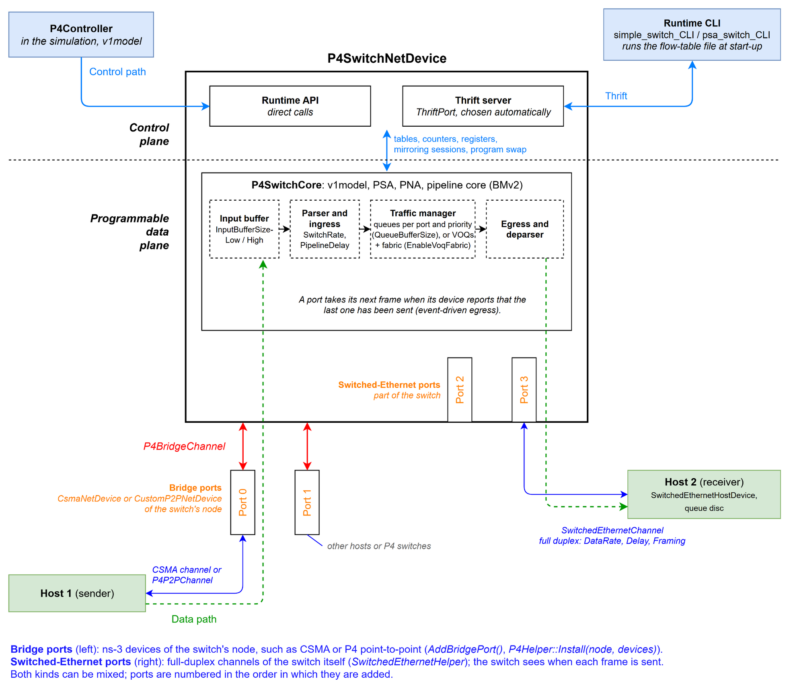

# P4sim in ns-3

<p align="center">
  <a href="https://arxiv.org/abs/2503.17554"></a>
  <a href="https://github.com/HapCommSys/p4sim-artifact-icns3"></a>
  <a href="https://github.com/p4lang/gsoc/blob/main/program/2025/README.md"></a>
  <a href="https://github.com/p4lang/gsoc/blob/main/program/2026/README.md"></a>
</p>

P4sim runs P4 programs in the [ns-3 network simulator](https://www.nsnam.org/): switches execute their P4 program on the BMv2 behavioral model, while ns-3 provides the topology, the traffic and the time. This lets you evaluate programmable networks in end-to-end simulations.

P4sim is open-source software licensed under the Apache License 2.0.

### Key Features

* **BMv2 behaviour**: the pipeline is [BMv2](https://github.com/p4lang/behavioral-model), the reference model of the P4 community. P4 programs and flow-table files written for BMv2 run unchanged.
* **ns-3 integration**: topology, traffic and timing come from ns-3, so P4sim combines with the other ns-3 modules.
* **Timing**: links serialise every frame at their data rate, a congested port sends back to back at its line rate, and the pipeline can have a packet rate (`SwitchRate`) and a latency (`PipelineDelay`). An optional traffic manager with virtual output queues models the fabric of a switch.
* **Scale**: built for large networks and high traffic rates.

---

### Architectural Overview

A `P4SwitchNetDevice` runs a P4 program on BMv2 and has two kinds of port, which can be mixed (see [Switch ports](#switch-ports)):

- **Bridge ports** (left in the figure): each port is an ordinary ns-3 device of the switch's node, such as a `CSMA` or a point-to-point device. This is the design of the `main` branch.
- **Switched-Ethernet ports** (right): each port is a full-duplex `SwitchedEthernetChannel` of the switch itself, so the switch sees when a port has sent a frame and controls its queues and timing.



Branches: `main` holds the current release (v1.0.0 and later fixes) with bridge ports only. `switch_channel`, this branch, is the development line for the next release: it adds the switched-Ethernet ports, the event-driven egress (v1model, PSA and PNA), the traffic manager, and `PipelineDelay`.

### Publications

- Mingyu Ma, Giang T. Nguyen. **"P4sim: Programming Protocol-independent Packet Processors in ns-3."** 2025. [[ACM DL]](https://dl.acm.org/doi/10.1145/3747204.3747210) [[arXiv]](https://arxiv.org/abs/2503.17554)
- **Reproducibility artifact:** [p4sim-artifact-icns3](https://github.com/HapCommSys/p4sim-artifact-icns3) — accepted at the 2025 International Conference on ns-3 (ICNS3).

Our implementation builds upon the P4-driven Network Simulator Module described in:

- Bai, Jiasong, *et al.* **"NS4: Enabling programmable data plane simulation."** Proc. of the Symposium on SDN Research, pp. 1–7, 2018. [[ACM DL]](https://dl.acm.org/doi/abs/10.1145/3185467.3185470)
- Fan, Chengze, *et al.* **"NS4: A P4-driven network simulator."** Proc. of the SIGCOMM Posters and Demos, pp. 105–107, 2017. [[ACM DL]](https://dl.acm.org/doi/10.1145/3123878.3132002)

---

## Installation & Setup

The following steps set up a local environment to run P4sim with **ns-3.39** on **Ubuntu 24.04 LTS**. P4sim is tested with ns-3.39, BMv2 1.15.8 and p4c 1.2.5.19.

> **Note:** The BMv2 and P4 software installation will take **1–2 hours** and consume up to **15 GB** of disk space.

> **Docker:** `docker build -t p4sim .` in this repository builds P4sim with the tested versions, p4c included, in 6 to 30 minutes (32 to 8 cores) and about 2 GB, without installing anything on the host; see [doc/docker.md](doc/docker.md).

> **Why ns-3.39 or earlier?** Starting from ns-3.40, ns-3 requires C++20. However, BMv2 is currently built with C++17. P4sim therefore supports ns-3.39 and earlier versions. We plan to upgrade once a C++20-compatible BMv2 build becomes available.

### Step 1: Initialize the Working Directory

```bash
sudo apt update
sudo apt install git vim cmake
mkdir ~/workdir && cd ~/workdir
```

### Step 2: Install BMv2 and P4 Dependencies

Install all required libraries and tools via the official [p4lang/tutorials](https://github.com/p4lang/tutorials) repository:

```bash
cd ~
git clone https://github.com/p4lang/tutorials
mkdir ~/src && cd ~/src
../tutorials/vm-ubuntu-24.04/install.sh |& tee log.txt
```

Verify the installation:

```bash
simple_switch --version
```

### Step 3: Clone and Build ns-3.39 with P4sim

```bash
cd ~/workdir
git clone https://github.com/nsnam/ns-3-dev-git.git ns3.39
cd ns3.39 && git checkout ns-3.39
```

Add the P4sim module:

```bash
cd contrib
git clone https://github.com/HapCommSys/p4sim.git
cd p4sim && sudo ./set_pkg_config_env.sh
```

The clone gives the `main` branch; for this branch, add `-b switch_channel` to `git clone`.

Configure and build:

```bash
cd ../..
./ns3 configure --enable-tests --enable-examples
./ns3 build
```

### Step 4: Run an Example and a Test Suite

```bash
./ns3 run p4-v1model-ipv4-forwarding
./test.py -s p4-packet
```

[doc/examples.md](doc/examples.md) lists the examples and [test/Readme.md](test/Readme.md) the test suites. [doc/vm-env.md](doc/vm-env.md) has the same steps, the setup in a virtual machine, and checks of the installation.

P4sim reads the P4 files (programs, flow tables, topologies) from the p4sim folder of the build, so no path needs to be set, and several ns-3 trees can live side by side.

> **Note:** Earlier versions asked you to set `P4SIM_DIR` in `~/.bashrc`. It is no longer needed; you can remove it. If it names another p4sim folder, it is ignored and a notice says so.

---

## Supported P4 Architectures

| Value | Architecture | BMv2 Target |
|-------|-------------|-------------|
| 0 | V1model | `simple_switch` |
| 1 | PSA | `psa_switch` |
| 2 | PNA | `pna_nic` |
| 3 | Pipeline (`P4CorePipeline`) | – |

---

## Switch Parameters

The P4 program and its flow tables define the forwarding. These attributes of `ns3::P4SwitchNetDevice` set up the switch in the simulation ([doc/p4sim.rst](doc/p4sim.rst) has their defaults):

| Attribute | Description |
|---|---|
| `JsonPath` | Path to the compiled P4 program (JSON) |
| `FlowTablePath` | Path to the flow-table file |
| `P4SwitchArch` | Architecture: 0 V1model, 1 PSA, 2 PNA, 3 Pipeline |
| `SwitchRate` | Packet rate of the whole P4 pipeline, in packets per second; 0 (default) = no limit |
| `PipelineDelay` | Latency of every packet in the P4 pipeline; 0 (default) = none. v1model, PSA and the pipeline core |
| `InputBufferSizeLow` | Input buffer for the packets received on the ports, in packets |
| `InputBufferSizeHigh` | v1model: input buffer for resubmitted and recirculated packets, served first |
| `QueueBufferSize` | Each output queue, in packets: per port and priority (v1model, PSA), or per port (PNA) |
| `EnableVoqFabric` | v1model: use the VOQ + fabric traffic manager instead of the output queues ([doc/traffic-manager.md](doc/traffic-manager.md)) |
| `EnableSwap` | Allow swapping the P4 program at run time (`load_new_config` and `swap_configs` of the runtime CLI, or `P4Controller`). The swap waits until the switch holds no packet; frames that arrive meanwhile wait and use the new program |
| `BmLogLevel` | Level of the BMv2 pipeline log in `/tmp/bmv2-<thrift port>-pipeline.log`, `trace` to `off`. `off` (default) writes none; `trace` logs every step of every packet, which helps to debug a P4 program but slows the simulation down |
| `ThriftPort` | Thrift port of the runtime CLI. 0 (default) picks the first free port from `$P4SIM_THRIFT_PORT_BASE` (9090), so simulations can run in parallel |
| `ChannelType`, `EnableTracing` | Deprecated, no effect; removed in the next major version. Trace packets with the trace sources of the devices (`MacTx`, `MacRx`, ...), `PacketSink` or `FlowMonitor` |

> **Notes:**
> 1. The P4 program sees every frame, ARP included, and must forward it.
> 2. `SwitchRate` models a slower switch, such as a software switch: an idle pipeline takes a packet at once, and packets that arrive while it is busy wait in the input buffer, or are dropped (`MacRxDrop`) when it is full. Resubmitted and recirculated passes count too. With the default, 0, only the links limit the traffic, as in a hardware switch. `PipelineDelay` adds a fixed latency instead and does not change the throughput.
> 3. The flow-table file runs in `simple_switch_CLI` (v1model) or `psa_switch_CLI` (PSA). Besides the table commands it can use `mirroring_add`, `mirroring_add_mc`, `set_queue_depth` and `set_queue_rate`, and on v1model `mirroring_delete`: BMv2 1.15.8's `psa_switch_CLI` stops at `mirroring_delete`, as at any failed mirroring command, and skips the rest of the file.

### Switch ports

A switch has two kinds of port, which can be mixed. The port number is the order in which the ports are added.

- **Switched-Ethernet ports**: `P4SwitchNetDevice::Attach()` with a `SwitchedEthernetChannel`, usually through `SwitchedEthernetHelper::Install()`, which also creates the hosts' devices (see [doc/switch.md](doc/switch.md)).
- **Bridge ports**: an ordinary ns-3 device of the switch's node, such as a CSMA or a P4 point-to-point device, added with `P4SwitchNetDevice::AddBridgePort()` or `P4Helper::Install(node, devices)`. Switches are connected to each other this way, and the topology reader (`p4-net-builder.h`) builds its networks with them.

---

## P4sim Development Workflow

1. **Write the P4 program** (headers, parser, tables, controls).
2. **Compile it** with `p4c` into a JSON file for BMv2.
3. **Write an ns-3 script** (in `scratch/` or `examples/`) that installs P4 switches on nodes.
4. **Fill the tables**: with a flow-table file at start-up, or with `P4Controller` during the simulation.
5. **Run it** and measure throughput, latency, or packet traces.

---

## Examples

[doc/examples.md](doc/examples.md) describes all 23 examples. A selection:

| Example | Description |
|---|---|
| `p4-v1model-ipv4-forwarding` | Two hosts and a switch with IPv4 forwarding (v1model) |
| `p4-v1model-ipv4-forwarding-bridge` | The same over point-to-point or CSMA bridge ports |
| `p4-psa-ipv4-forwarding`, `p4-pna-ipv4-forwarding` | The same with PSA and PNA |
| `p4-basic-example` | Four hosts and four switches (p4lang tutorial `basic`) |
| `p4-basic-controller` | Flow entries changed by `P4Controller` during the simulation |
| `p4-basic-tunnel` | A tunnel with a custom header |
| `p4-firewall` | A stateful TCP firewall |
| `p4-spine-leaf-topo` | A spine-leaf network with ECMP load balancing |
| `p4-topo-fattree` | A generated k-ary fat tree with its flow tables |
| `p4-voq-fabric-throughput` | Throughput of the VOQ + fabric traffic manager |

The [paper](https://dl.acm.org/doi/10.1145/3747204.3747210) evaluates P4sim with tunnelling (a custom header) and load balancing over several paths.

---

## Documentation

| File | Contents |
|---|---|
| [doc/vm-env.md](doc/vm-env.md) | Installation, locally or in a virtual machine |
| [doc/docker.md](doc/docker.md) | Building and running P4sim in Docker |
| [doc/examples.md](doc/examples.md) | All examples and the format of their P4 files |
| [doc/switch.md](doc/switch.md) | Switched-Ethernet ports and host devices, timing on the wire, host queues |
| [doc/traffic-manager.md](doc/traffic-manager.md) | The VOQ + fabric traffic manager |
| [doc/event-driven-tm-scheduler.md](doc/event-driven-tm-scheduler.md) | How the egress sends the next frame when a port is free |
| [doc/p4sim.rst](doc/p4sim.rst) | The model in the format of the ns-3 documentation |
| [test/Readme.md](test/Readme.md) | The test suites and how to write a test |
| [doc/TODO.md](doc/TODO.md) | Open design questions, feature gaps and known bugs |

---

## Known Limitations

- `SwitchRate` models only the throughput of the P4 pipeline, not its per-packet latency: a packet that finds the pipeline idle passes it without delay. Use `PipelineDelay` for the latency.
- Every device stores a frame completely before it forwards it; P4sim does not forward cut-through, and it does not model the stages of a hardware pipeline.
- ns-3.39 or earlier only, because BMv2 is built with C++17.
- PNA ignores `PipelineDelay`, has no Thrift service of its own, and does not load its `FlowTablePath`.
- `P4Controller` works on v1model switches only.
- `digest()` sends its records to BMv2's notification socket; nothing in the simulation receives them.
- The pipeline core (`P4SwitchArch` 3) has no output queue: a congested port can lose frames.
- The Thrift server of a switch runs in its own thread: use the runtime CLIs before and after the simulation, and `P4Controller` during it.

[doc/TODO.md](doc/TODO.md) has the details and the other open items.

---

## Generating Doxygen Documentation

```bash
sudo apt install doxygen graphviz dia
./ns3 configure --enable-tests --enable-examples
./ns3 build
./ns3 docs doxygen
xdg-open build/doxygen/html/index.html
```

---

## Maintainers & Contributors

- **Maintainers**: [Mingyu Ma](mailto:mingyu.ma@tu-dresden.de)
- **Contributors**: Thanks to [GSoC 2025 & 2026](https://summerofcode.withgoogle.com/) with [Davide](mailto:d.scano89@gmail.com) support and contributor [Vineet](https://github.com/Vineet1101).
